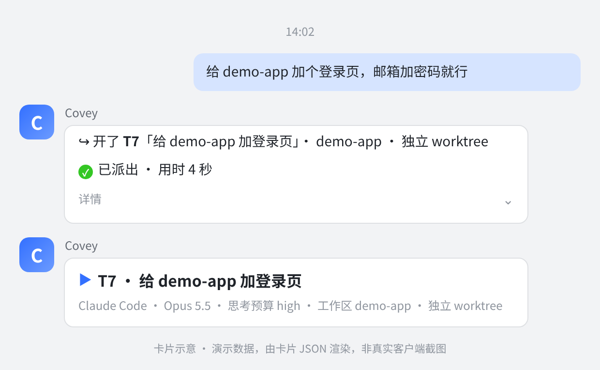
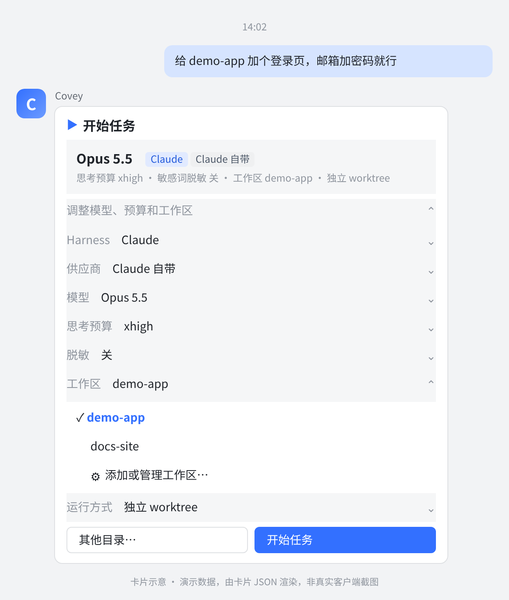

# Covey

[中文](README.md)

Covey drives the coding agents on your own development machine from Feishu (Lark) chat. One bot connects Codex, Claude Code, DeepSeek Harness (dsh) and Pi; one Feishu topic is one agent session, and the task, follow-ups, steering, questions and results all stay in that topic. More harnesses can be added through [extensions](docs/architecture.md#扩展).

The bot runs on your own machine, is bound to one Feishu user (the owner) and uses the owner's own model authorization. A colleague who wants their own main thread, board and model authorization deploys their own; you can also activate a group so colleagues can @ the bot to open topics (a team space).

Most of the documentation is written in Chinese for now.

## What it looks like

These are **card sketches** rendered from Covey's card JSON with demo data, not screenshots of the real client; the real look is whatever Feishu draws. The interface is in Chinese.



In the private chat, one sentence is enough: the main thread opens a topic for it



The launch card: pick model, thinking budget, workspace and run mode


The task card: a live execution trace, with buttons to steer, switch config or stop


The answer card: the conclusion, artifact links, input and output


The settings card, redaction tab: type the words, stand-ins are generated automatically

## What it does

- **A topic is a session.** Send a message to open a topic, pick model, thinking budget, workspace and run mode, and start; later messages in the topic continue the same session.
- **Private-chat main thread.** What you write at the top level of the private chat goes to one resident Claude Code session. It answers quick questions itself and opens topics for real work; the conclusions come back to the chat.
- **Work on the card.** Watch the execution trace, stop a task, steer it while it runs, answer the model's questions, switch harness or model mid-conversation; Claude topics can also step back one turn.
- **Results and artifacts.** The answer is sent as its own card; registered artifacts are uploaded to cloud storage with a link.
- **Long tasks survive restarts.** Each task runs in its own process, so restarting or upgrading the bot does not stop it.
- **Spaces.** The private chat and every bound group is a "space". A personal space is yours alone and has the main thread, the board and the menu cards; a team space is an activated group where colleagues @ the bot to open topics; a proxy space is the group used for proxy replies. See [configuration](docs/configuration.md#空间spaces).
- **Optional features**, off by default: a topic board and daily digests, proxy replies, sensitive-word redaction, parallel tracks and live dispatch cards for the private chat (several things asked in a row run side by side, and work handed off shows a live card in the chat), and devices (a topic runs Claude Code or Codex on another machine of yours over SSH; in development). See [configuration](docs/configuration.md). For redaction you type the words on the settings card and the stand-in words are generated automatically; it replaces text only in topics that turned it on, and only for Claude models.

## Quick start

Requirements: Claude Code or Codex installed and logged in on this machine, Linux or macOS, Python 3.10+.

```bash
git clone https://github.com/ericxk/covey.git && cd covey
./install        # scan the QR code in the terminal once with the Feishu mobile app
```

Then send the bot a message in a private chat. Options and troubleshooting: [docs/install.md](docs/install.md).

## Documentation

All in Chinese: [install](docs/install.md), [usage](docs/usage.md), [configuration](docs/configuration.md), [operations](docs/operations.md), [troubleshooting](docs/troubleshooting.md), [harnesses](docs/harnesses.md), [architecture](docs/architecture.md), [testing](docs/testing.md), and [AGENTS.md](AGENTS.md) (code map and the rules most easily broken).

## Extensions

The core refers to nothing but the built-in harnesses. A deployment can put extension packages under `extensions/` and enable them with `extensions/enabled` or the `COVEY_EXTENSIONS` environment variable; an extension merges its harnesses, providers and menu items into the core's tables through its manifest. See the extension section of [architecture](docs/architecture.md#扩展).

## Contributing

See [CONTRIBUTING.md](CONTRIBUTING.md). License: [MIT](LICENSE).
