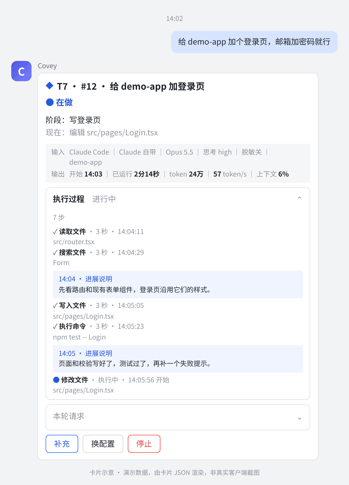
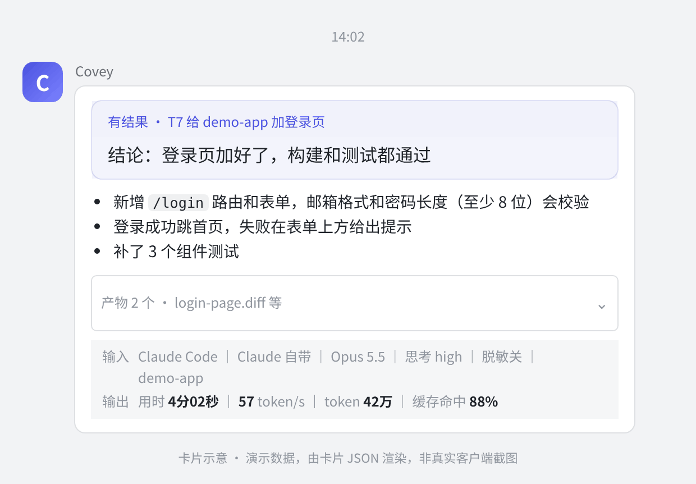
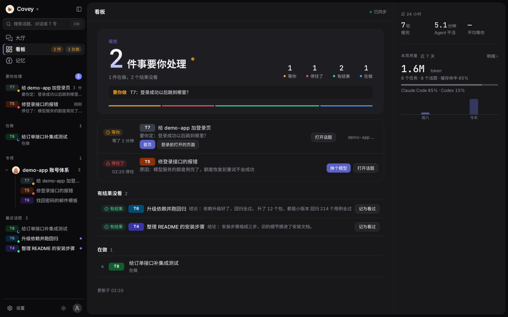
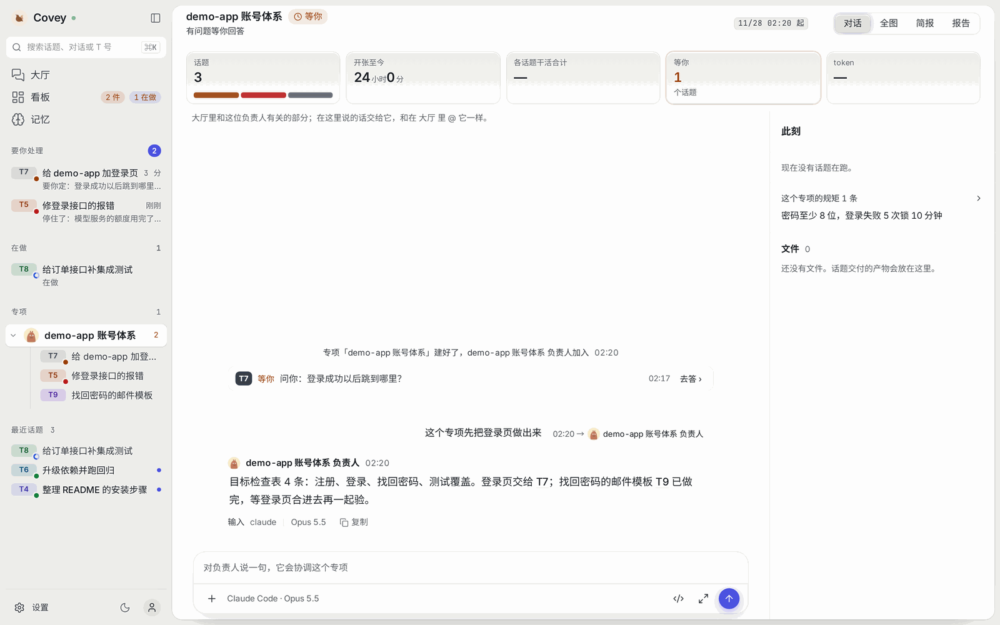
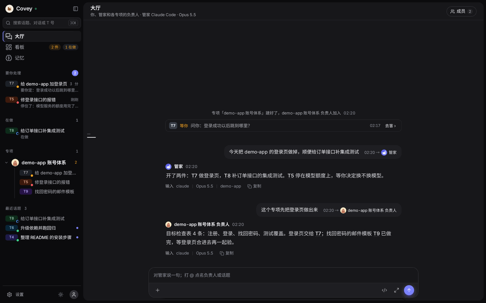
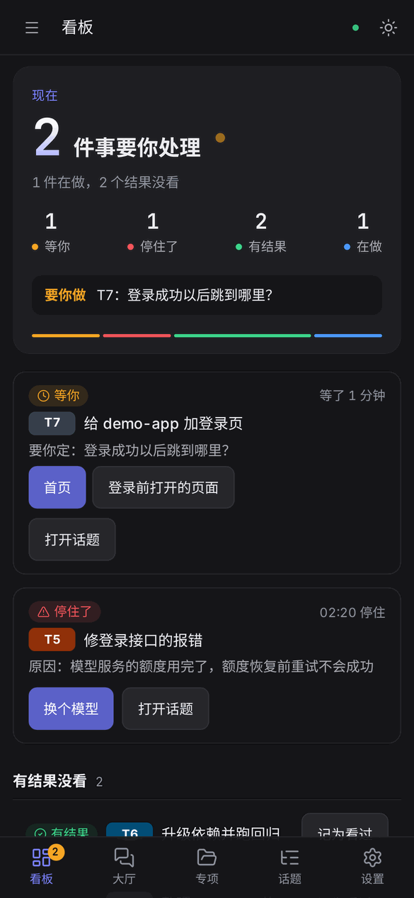

<p align="center">
  <picture>
    <source media="(prefers-color-scheme: dark)" srcset="docs/media/brand/hero-en-dark.svg">
    
  </picture>
</p>

<p align="center">
  <a href="https://github.com/ericxk/covey/actions/workflows/ci.yml"></a>
  <a href="LICENSE"></a>
  <a href="pyproject.toml"></a>
  <a href="https://github.com/ericxk/covey/tags"></a>
</p>

<p align="center">
  <a href="#quick-start">Quick start</a> ·
  <a href="https://ericxk.github.io/covey/">Live demo</a> ·
  <a href="#documentation">Documentation</a> ·
  <a href="README.md">中文</a>
</p>

**One person, a whole team of coding agents.** Say one sentence in a private chat with your bot. The butler turns it into a complete task description and hands it out; work that spans days goes to a project lead that breaks it down and sees it through; Claude Code, Codex and Antigravity each do their part on your own development machine; the rules you set live in memory and travel with every turn. No more watching processes or copying context around: you state what you want and make the calls on question cards.

Covey is built for Feishu, the Chinese edition of Lark (the installer sets up a Feishu app), for people who keep several coding agents busy at once and find they have become the dispatcher. Most of the documentation is in Chinese for now.

<p align="center">
  <picture>
    <source media="(prefers-color-scheme: dark)" srcset="docs/media/demo/flow-en-dark.gif">
    
  </picture>
</p>

<sub>Card sketches drawn from Covey's card JSON with demo data, not screenshots of the real client; Feishu draws the real thing. The interface is in Chinese. To click through it yourself: the [live demo](https://ericxk.github.io/covey/), or open the [three-step demo page](docs/demo/index.html) in a browser from a checkout (hand off to a topic → answer a question → see the answer and its artifacts).</sub>


## Quick start

Requirements: Linux or macOS, Python 3.10+, Node.js and npm (`./install` installs `lark-cli` with npm when it is missing; without npm it stops and tells you to install Node.js), one of Claude Code, Codex or Antigravity installed and logged in on this machine, and a Feishu account (you scan a QR code with the phone app).

```bash
git clone https://github.com/ericxk/covey.git && cd covey
./install        # scan the QR code in the terminal once with the Feishu mobile app
```

The installer creates the Feishu app, adds its permissions, events and menu, registers the background service, and finishes once your first message in the private chat has been answered. Common options:

| Option | What it does |
| --- | --- |
| `--showcase` | The showcase set: on top of the defaults, collaboration between topics (in development), the pinned "on your plate" card and topic pins, daily digests, parallel tracks for the butler, dispatch cards |
| `--web` | Self-host the web workbench on this machine (needs Node 22+ and npm) |
| `--web-public ADDR` | Also serve the web workbench over HTTPS on a public IP or domain (implies `--web`) |

No Claude Code? It installs anyway: the butler runs on whichever of Codex or Antigravity answered, and projects stay on ([install, without Claude Code](docs/install.md#没有-claude-code-时)). All options and troubleshooting: [install](docs/install.md).

## A team that runs itself; you make the calls

<p align="center">
  <picture>
    <source media="(prefers-color-scheme: dark)" srcset="docs/media/brand/workflow-en-dark.svg">
    
  </picture>
</p>

You say one sentence → the butler turns it into a task description and hands it out → topics work in sessions of their own, with a lead following work that spans days → a question card when the call is yours → the result comes back to the chat.

Once several agents run at the same time, the bottleneck is rarely the model. It is you: opening terminals, picking directories, remembering which session does what, copying context between them, and checking back to see whether one stopped. You have become the dispatcher. Covey hands the dispatching to a team with clear roles:

| Layer | What it handles | What you stop doing |
| --- | --- | --- |
| Butler | The only one you talk to in the private chat. Answers what it can right away; for work that needs reading or changing code, writes a task description and opens a topic, or forwards your words to the topic already on it | Opening terminals, picking directories, turning one sentence into a prompt |
| Project lead ("lead") | Work that spans days and several topics: breaks it down, delegates it to topics, follows up, wraps up | Remembering who is where and who goes next |
| Topic | One session and one process per job, with its own harness, model and workspace; brings the result back to the chat | Copying context between sessions |
| Memory | The rules, agreements and decisions you made, carried by every turn | Saying the same thing twice |

### The butler: one sentence becomes a job that can run on its own

- You say one sentence; the butler fills it out into a task description: what done looks like (completion criteria), which repository, which memory entries to carry. The topic can work through it without coming back to ask what you meant.
- Thought of something while a topic is running? Say it in the private chat and the butler works out which topic it belongs to. Even while the butler is handling one request, you can send the next one without waiting.
- Topics that finish close together bring their results back as one card.

### The lead: work that spans days has someone in charge

- The lead breaks down work, delegates it, follows up and wraps up; it writes no code itself. When a topic finishes a turn or you say something, the lead wakes up, reads what came back and decides who does what next.
- It sees the topics' questions first and passes on the ones that are yours with a recommendation; when a project stalls, it asks you whether to go on, wrap up or stop.
- As topics pile up, project tidying proposes a project; nothing is created until you click.

### Memory: it follows your rules and knows who said what

- Standing instructions, what you asked it to "remember" and what a project agreed form one memory that travels with every turn. When you say things like "from now on", "never again" or "remember", it writes them down after the turn.
- Scoped: global, project, topic; the narrower scope wins.
- Sourced: each entry says whether you said it or the agent inferred it. An agent-inferred rule is only a reference: it cannot approve any of the actions that need your sign-off, and one it thinks should apply everywhere takes effect only after you accept it.
- Tap Wrong (不对) under an answer to retract a bad entry.

### It asks only when the call is yours

- A decision comes as a question card: tap an option and it is sent. There is no default answer, and no answer is never taken as a yes.
- Deploying, deleting, spending money, messaging other people and reserving machines always need your confirmation first. Small things that can be undone are done the recommended way, and the result says what was chosen for you and how to change it back.
- The board (看板) in the bot's menu shows on one card what waits for you, what stopped, which results you have not seen and what is running.

### Hand it off and walk away

- Every task runs in a process of its own, so restarting or upgrading the bot does not stop it.
- After a rate limit or a transient error from the model service, it waits until it can go on and resumes by itself, for up to about three hours.
- A topic waiting on CI or a training run sets a time to come back and check, and stays quiet when nothing has changed.

### Switch models without starting over

- One bot connects Claude Code, Codex, Antigravity and DeepSeek Harness (dsh); the butler and leads run on any of the first three, so you are not tied to one vendor.
- Halfway through a topic you can change its harness, model or workspace and keep talking.

### Inside Feishu, and safe to bring to work

- No extra app to install: Feishu on your phone, desktop or the web is the client, and installing takes one QR scan.
- The bot serves you alone. A group is enabled only after you confirm it in the private chat, and group members can be limited to read-only. An official refusal stops the turn instead of retrying around it.

## How it differs

Most tools make one agent stronger, or make one agent easier to drive from afar. Covey lets one person run a team of them.

| | The usual way | Covey |
| --- | --- | --- |
| Who dispatches | Chat remotes mostly pass messages through to one session; tools that run agents in parallel can start several, but splitting the work, tracking progress and handing off between sessions are still mostly on you | The butler hands out work and leads follow up; they do the hand-offs between topics |
| Where you are | Agent IDEs and desktop workbenches live at the editor on your desk, with the phone and chat as extensions | It does not compete with your editor; it keeps going when you leave the desk, and Feishu on your phone is enough to make a call |
| How it asks | Mostly an approval prompt before each tool call, which stalls when you are away; or everything allowed up front to keep it moving | Decisions that are yours become question cards, with no default answer and no answer never a yes; small things that can be undone follow your rules and say how to change them back |
| What it remembers | Mostly rule files written by hand per repository or globally, or memories saved automatically without saying who said them or how much they count | Scoped, sourced and weighted: what the agent inferred cannot approve what needs your sign-off |
| Models | Each vendor's own CLI keeps to itself; switching usually means a new session and moving the context yourself | One bot drives several CLIs, a topic can switch midway, and the butler and leads are not tied to one |
| Scope and client | All-round personal assistants cover everyday life and office work, with coding as one skill among many, and many need their own client | Coding agent teams only, inside the Feishu your team already uses |

## The cards

<table>
<tr>
<td width="33%"><br><sub>Task card: a live execution trace; steer, switch config or stop at any time</sub></td>
<td width="33%"><br><sub>Question card: one tap sends an option; no default answer</sub></td>
<td width="33%"><br><sub>Answer card: the conclusion, artifacts and changes, input and output</sub></td>
</tr>
</table>

<details>
<summary>Four more: stopped, switch config, the board, launch card</summary>

<table>
<tr>
<td width="50%"><br><sub>Stopped: why and what next, in plain words; out of quota, switch the model</sub></td>
<td width="50%"><br><sub>Switch config: change harness, model or workspace mid-conversation</sub></td>
</tr>
<tr>
<td width="50%"><br><sub>The board: what needs you, and what to look at first</sub></td>
<td width="50%"><br><sub>Launch card: without a butler, each new topic picks its model and workspace first</sub></td>
</tr>
</table>

</details>

## Web workbench (open source, optional)

Better for long answers and history on a computer: the projects, topics, turns and pending questions of your private chat are all on the page, where you can also talk, answer, stop a topic, start a new one and change settings. It reads and writes the same records as Feishu, which keeps the notifications and quick replies.



<details>
<summary>Project page, the room, on a phone</summary>

<table>
<tr>
<td width="40%"><br><sub>Project page: the lead's conversation; memory split into "you said" and "summed up"</sub></td>
<td width="40%"><br><sub>The room: you, the butler and every project's lead on one timeline</sub></td>
<td width="20%"><br><sub>On a phone</sub></td>
</tr>
</table>

</details>

<sub>Web screenshots: the self-hosted version filled with demo data, no real data.</sub>

The web workbench source is in [`web/`](web/README.md), with two ways to deploy it:

- **One-step deploy to Feishu's full-stack app platform**: if your Feishu organisation has it, one command deploys the page as an app of your own; the platform provides the address, TLS and Feishu login, so you can open it from the Feishu app on your phone anywhere. See [Deploy in web/README.md](web/README.md#部署).
- **No such platform, or you want the data to stay on your machine**: `./install --web` self-hosts it on this machine; `./install --web-public <IP or domain>` also serves it over HTTPS on a public address, so a cloud server or a machine at home with a public address can be reached from outside. The first login is approved with one tap in your Feishu private chat. See [docs/install.md](docs/install.md#网页工作台可选) and [web/deploy/selfhost](web/deploy/selfhost/README.md).

## After installing

1. **First message**: write to the bot in a private chat; the butler answers or opens a topic. One page of how to use it: [five-minute start](docs/quickstart.md); then walk through [first use](docs/usage.md#第一次使用).
2. **On by default**: the butler, projects, project tidying (proposals only), the board (看板) menu item, revisits, memory (including learning on its own) and knowledge entries. Recalling or editing a message stops or updates its task, and what you write in a topic while its task runs goes straight into it. What else can be turned on and how: [switches at a glance](docs/configuration.md#开关速查); to turn the whole showcase set on in a running bot, see [the showcase set](docs/configuration.md#演示套餐).
3. **Upgrade**: run `scripts/upgrade.sh` in the checkout (`--dry-run` first to see what it would do). It takes the new upstream commit and deploys it as a fixed release with the service's own settings; the bot restarts in a few seconds, and running tasks go on as the new process takes them over. Do not `git pull` in the checkout the service runs from. See [daily upgrades](docs/deploy.md#日常升级).

## Documentation

All in Chinese.

- **Getting started and use**: [install](docs/install.md), [five-minute start](docs/quickstart.md) (one page; the butler reads it when asked how to use Covey), [usage](docs/usage.md), [usage reference](docs/reference.md), [butler](docs/butler.md), [projects](docs/projects.md), [web workbench](docs/web.md), [proxy replies](docs/proxy.md), [troubleshooting](docs/troubleshooting.md).
- **Deployment and configuration**: [configuration](docs/configuration.md), [harnesses](docs/harnesses.md), [operations](docs/operations.md), [upgrade and deploy](docs/deploy.md), [Feishu app configuration](docs/feishu-app.md), [manual install](docs/manual-install.md), [renaming and compatibility](docs/compat.md), [retired features and old configuration](docs/legacy.md), [policy stops](docs/policy-stop.md), [runtime locks](docs/runtime-locks.md).
- **Development**: [architecture](docs/architecture.md), [butler internals](docs/butler-internals.md), [cards](docs/cards.md), [UI](docs/ui.md), [testing](docs/testing.md), [glossary](docs/glossary.md), [AGENTS.md](AGENTS.md) (code map and the rules most easily broken), [CONTRIBUTING.md](CONTRIBUTING.md).

## Extensions

The core refers to nothing but the built-in harnesses. An extension is a package with a manifest (its `manifest` module) under `extensions/` of the code that runs (a fixed release gets it from `scripts/deploy_bridge.sh --ext-repo`); its manifest merges harnesses, providers, model gateways, menu items and hooks into the core's tables. Once it is there, `python3 -B bin/covey_plugins.py list`, `enable <package>` and `disable <package>` manage it, and `covey_service.py restart` puts a change into effect; see [operations](docs/operations.md#扩展的装和卸) and [architecture](docs/architecture.md#扩展). An extension's own install steps come with it.

## Contributing

See [CONTRIBUTING.md](CONTRIBUTING.md). License: [MIT](LICENSE).
