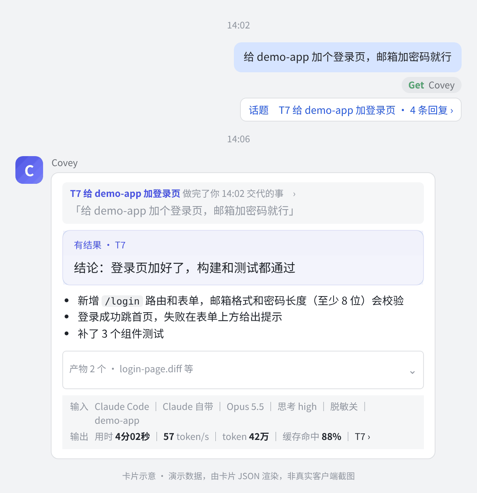
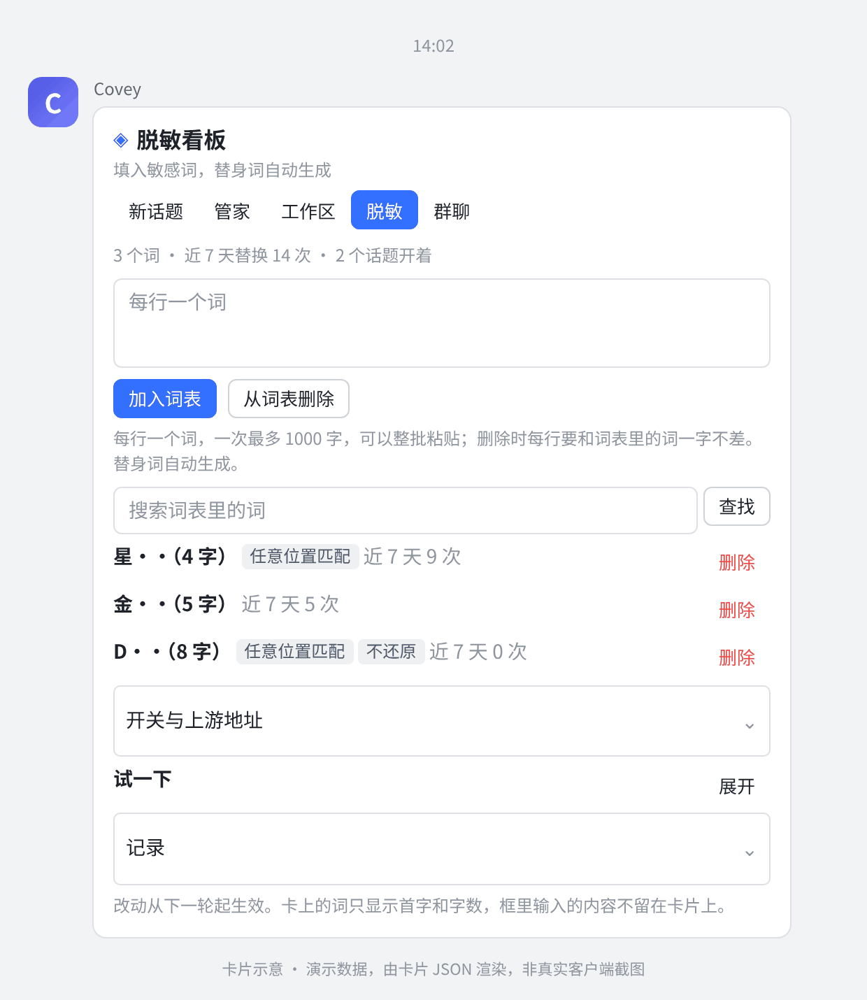

# Covey

[中文](README.md)

Covey drives the coding agents on your own development machine from Feishu (Lark) chat. One bot connects Codex, Claude Code, DeepSeek Harness (dsh), Pi and Antigravity (agy); one Feishu topic is one agent session, and the task, follow-ups, steering, questions and results all stay in that topic. More harnesses can be added through [extensions](docs/architecture.md#扩展).

The bot runs on your own machine, is bound to one Feishu user (the owner) and uses the owner's own model authorization. A colleague who wants their own butler, board and model authorization deploys their own; you can also activate a group so colleagues can @ the bot to open topics (a team space).

Most of the documentation is written in Chinese for now.

## What it looks like

These are **card sketches** rendered from Covey's card JSON with demo data, not screenshots of the real client; the real look is whatever Feishu draws. The interface is in Chinese.



In the private chat, one sentence is enough: the butler opens a topic under it and brings the conclusion back


The launch card: pick model, thinking budget, workspace and run mode


The task card: a live execution trace, with buttons to steer, switch config or stop


The answer card: the conclusion, artifact links, input and output



The settings card, redaction tab: type the words, stand-ins are generated automatically

## What it does

- **A topic is a session.** Send a message to open a topic, pick model, thinking budget, workspace and run mode, and start; later messages in the topic continue the same session.
- **Private-chat butler.** What you write at the top level of the private chat goes to one resident Claude Code session. It answers quick questions itself and opens topics for real work; the conclusions come back to the chat.
- **Work on the card.** Watch the execution trace, stop a task, steer it while it runs, answer the model's questions, switch harness or model mid-conversation; Claude topics can also step back one turn.
- **Results and artifacts.** The answer is sent as its own card; registered artifacts are uploaded to cloud storage with a link.
- **Long tasks survive restarts.** Each task runs in its own process, so restarting or upgrading the bot does not stop it.
- **Spaces.** The private chat and every bound group is a "space". A personal space is yours alone and has the butler, the board and the menu cards; a team space is an activated group where colleagues @ the bot to open topics; a proxy space is the group used for proxy replies. See [configuration](docs/configuration.md#空间spaces).
- **On after install**: the butler, projects (the butler hands long work to a lead topic that dispatches and follows it), project tidying (it only proposes; nothing is built until you click), "use the recommendation for such questions from now on" under question cards, the 看板 menu item (what waits, stopped and runs, at any time), following up when you recall or edit a message, and sensitive-word redaction on the settings card (replaces text only in topics that turned it on, Claude models only).
- **Off until you turn them on**: daily digests, the pinned "on your plate" card and topic pins, memory, knowledge entries, parallel tracks for the butler, dispatch cards; needing more set-up: proxy replies (an extension with a sender), the web workbench, devices (in development), node monitoring. Which are on and how to turn one on: [configuration, switches at a glance](docs/configuration.md#开关速查).

## Quick start

Requirements: Claude Code or Codex installed and logged in on this machine, Linux or macOS, Python 3.10+.

```bash
git clone https://github.com/ericxk/covey.git && cd covey
./install        # scan the QR code in the terminal once with the Feishu mobile app
```

Then send the bot a message in a private chat. Options and troubleshooting: [docs/install.md](docs/install.md). Colleagues installing the core together with their company's extension follow the 「同事第一次安装」 section of the extension repository's README instead of the steps above.

## After installing

1. **First message**: write to the bot in a private chat; the butler answers or opens a topic. Walk through [first use](docs/usage.md#第一次使用).
2. **Turn on more**: a new install has only the features above on; recommended ones are listed [here](docs/configuration.md#推荐打开), and a switch is changed in [three steps](docs/configuration.md#改开关三步).
3. **Upgrade**: after `git fetch`, `scripts/deploy_bridge.sh` deploys the new commit as a fixed release; run it with `--check-only` first, and do not `git pull` in the checkout the service runs from. See [upgrade and rollback](docs/deploy.md#升级与回滚).

## Documentation

All in Chinese.

- **Getting started and use**: [install](docs/install.md), [five-minute start](docs/quickstart.md) (one page, in Chinese; the butler reads it when asked how to use Covey), [usage](docs/usage.md), [usage reference](docs/reference.md), [butler](docs/butler.md), [projects](docs/projects.md), [web workbench](docs/web.md), [proxy replies](docs/proxy.md), [troubleshooting](docs/troubleshooting.md).
- **Deployment and configuration**: [configuration](docs/configuration.md), [harnesses](docs/harnesses.md), [operations](docs/operations.md), [upgrade and deploy](docs/deploy.md), [Feishu app configuration](docs/feishu-app.md), [manual install](docs/manual-install.md), [renaming and compatibility](docs/compat.md), [retired features and old configuration](docs/legacy.md), [policy stops](docs/policy-stop.md), [runtime locks](docs/runtime-locks.md).
- **Development**: [architecture](docs/architecture.md), [butler internals](docs/butler-internals.md), [cards](docs/cards.md), [UI](docs/ui.md), [testing](docs/testing.md), [glossary](docs/glossary.md), [AGENTS.md](AGENTS.md) (code map and the rules most easily broken), [CONTRIBUTING.md](CONTRIBUTING.md).

## Extensions

The core refers to nothing but the built-in harnesses. An extension is a package with a manifest (its `manifest` module) under `extensions/` of the code that runs (a fixed release gets it from `scripts/deploy_bridge.sh --ext-repo`); its manifest merges harnesses, providers, model gateways, menu items and hooks into the core's tables. Once it is there, `python3 -B bin/covey_plugins.py list`, `enable <package>` and `disable <package>` manage it, and `covey_service.py restart` puts a change into effect; see [operations](docs/operations.md#扩展的装和卸) and [architecture](docs/architecture.md#扩展). The `COVEY_EXTENSIONS` variable overrides that list and is meant for development only.

## Contributing

See [CONTRIBUTING.md](CONTRIBUTING.md). License: [MIT](LICENSE).
