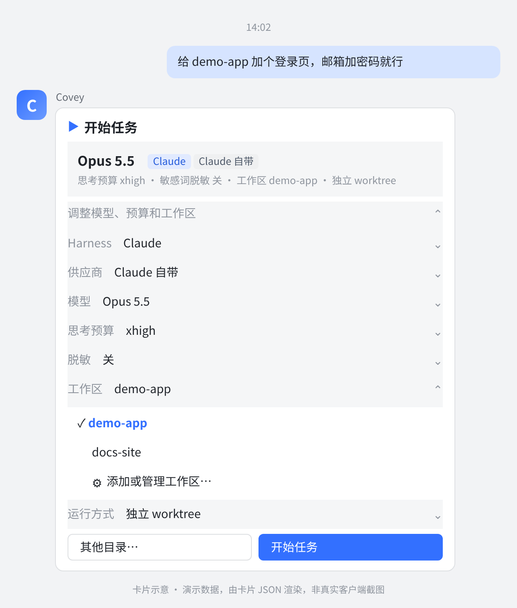
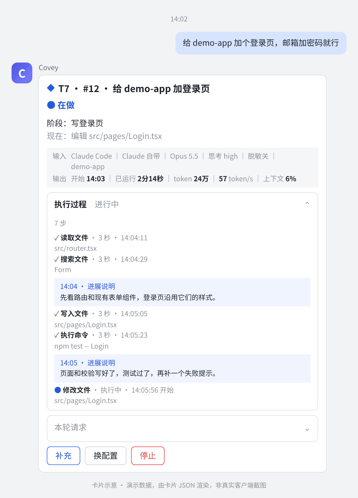
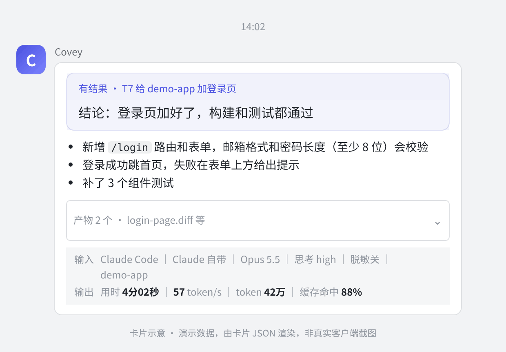
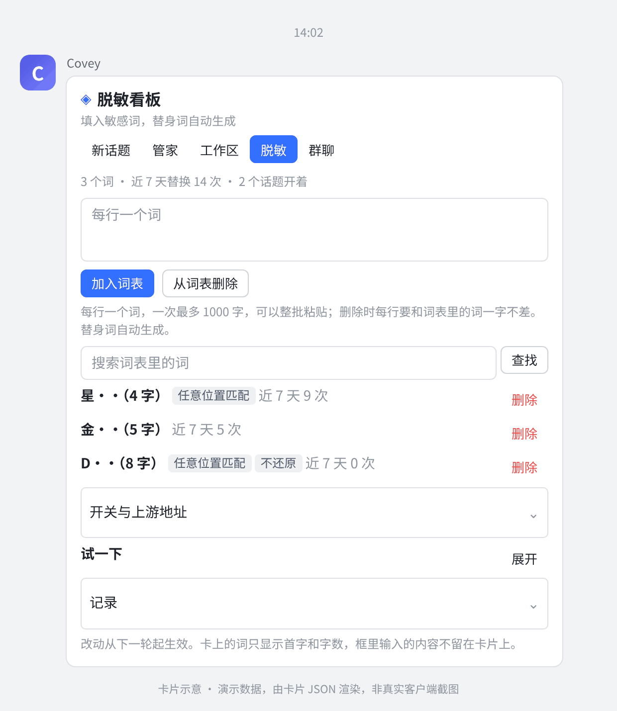

# Covey

[English](README.en.md)

Covey 在飞书里驱动你自己开发机上的编程 Agent。一个机器人接入 Codex、Claude Code、DeepSeek Harness（dsh）、Pi 和 Antigravity（agy）；一个飞书话题对应一个 Agent 会话，任务、追问、补充、问答和结果都留在这个话题里。更多 Harness 可以通过[扩展](docs/architecture.md#扩展)加进来。

机器人跑在你自己的机器上，绑定一个飞书用户（主人），用主人自己的模型授权。同事想用自己的管家、看板和模型授权，各自部署一个；也可以激活一个群，让同事 @ 机器人开话题（团队空间）。

## 界面一览

下面是用演示数据渲染的**卡片示意**：由 Covey 的卡片 JSON 画成，不是真实客户端截图，实际样子以飞书里为准。


私聊里发一句话，管家开出话题挂在下面，做完把结论带回私聊



话题里的启动卡：选模型、思考预算、工作区和运行方式



任务卡：执行过程实时更新，随时补充、换配置或停止



答案卡：结论、产物链接和输入/输出



设置卡的“脱敏”页：填词即可，替身词自动生成

## 能做什么

- **话题就是会话**：发一条消息开一个话题，选模型、思考预算、工作区和运行方式后开始；话题里的后续消息沿用同一个会话。
- **私聊管家**：私聊顶层的话交给一个常驻的会话（默认 Claude Code，也能换成 Codex、Antigravity）。能马上答的它直接答，要做的事它开话题去做，结论回到聊天区。
- **卡片上操作**：看执行过程，停止任务，执行中补充要求，回答模型的提问，聊到一半换 Harness 或模型，Claude 话题还能回退一步。
- **结果和产物**：答案单独发成一张卡，登记的产物上传云空间并给出链接。
- **长任务不怕重启**：每个任务在自己的任务进程里运行，机器人重启或升级时任务继续。
- **空间**：私聊和每个绑定的群是一个“空间”。个人空间只有你，有管家、看板和菜单卡；团队空间是激活的群，同事 @ 机器人开话题；代答空间是代答用的群。设置见[配置](docs/configuration.md#空间spaces)。
- **装好就开着的**：管家、专项（管家把长活交给一个负责人话题去分派和跟进）、整理专项（只提议，你点了才建）、问题卡上的「以后这类按推荐走」、菜单「看板」（随时看等你、停住、在做的事）、撤回或编辑消息后跟着停或补充、任务在跑时在话题里发的话直接补充给它（`COVEY_TOPIC_STEER`）、设置卡里的敏感词脱敏（话题开了才替换，只支持 Claude 的模型）。
- **要自己打开的**：早晚汇总、置顶的「手上的事」和话题看板、记忆、知识条目、管家同时做几件事、派发卡；要额外准备的有代答（要带发送器的扩展）、网页工作台、多设备（开发中）、节点监控。哪些开着、怎么打开见[配置 · 开关速查](docs/configuration.md#开关速查)。

## 快速开始

前提：机器上已装好并登录了 Claude Code 或 Codex，Linux 或 macOS，Python 3.10+。

```bash
git clone https://github.com/ericxk/covey.git && cd covey
./install        # 终端里出现二维码时，用飞书手机端扫一次
```

装完去飞书私聊机器人发一句话。选项和常见问题见[安装](docs/install.md)。公司同事装核心加扩展，照扩展库 README 的「同事第一次安装」一节装，不用照下面的步骤。

## 装好以后

1. **第一句话**：私聊机器人发一句话，管家直接回答或开一个话题去做；一页纸的用法见[五分钟上手](docs/quickstart.md)，再照[使用指南 · 第一次使用](docs/usage.md#第一次使用)走一遍。
2. **再打开几个功能**：新装只开了上面“装好就开着的”几项，推荐再开的见[开关速查](docs/configuration.md#推荐打开)，改开关按[三步](docs/configuration.md#改开关三步)做。
3. **升级**：`git fetch` 后用 `scripts/deploy_bridge.sh` 把新提交部署成固定的 release，先 `--check-only`；不要在服务运行的检出里直接 `git pull`。见[升级与回滚](docs/deploy.md#升级与回滚)。

## 文档

**上手与使用**

| 文档 | 内容 |
| --- | --- |
| [安装](docs/install.md) | `./install` 的前提、过程、选项、验收、常见问题 |
| [五分钟上手](docs/quickstart.md) | 一页纸：第一句话、日常怎么用、常被问到的（看板在哪、怎么开记忆）；管家被问到用法时先读它 |
| [使用指南](docs/usage.md) | 第一次使用、开任务、补充、回答、换配置、任务卡、管家、看板、群聊、代答 |
| [使用参考](docs/reference.md) | 使用指南各节的细节：启动卡和设置卡各项、任务卡状态行、补充的送达状态、问题卡、答案卡、看板和汇总、代答卡、自动重试 |
| [管家](docs/butler.md) | 私聊管家是什么、一轮怎么走、开话题和回带、工具、原则、知识库、记忆、设置卡 |
| [专项](docs/projects.md) | 分几个话题、跨几天推进的事：专项卡、负责人、问题分流、整理专项 |
| [网页工作台](docs/web.md) | 配套网页：怎么开、网页上能做什么、给前端的数据契约 |
| [代答](docs/proxy.md) | 替你回复白名单里的人：前置条件、怎么开、实现 |
| [排障](docs/troubleshooting.md) | 先找到数据根和 APP_ID，再按现象查：安装、没反应、服务、按钮、模型、任务、代答、飞书应用 |

**部署与配置**

| 文档 | 内容 |
| --- | --- |
| [配置](docs/configuration.md) | 开关速查（默认已开、推荐打开、按需打开）、改开关三步、`harnesses.json`、全部环境变量 |
| [Harness 说明](docs/harnesses.md) | 支持哪些 Harness、安装登录、选模型、各 Harness 的参数、模型网关、手工加一个 Harness |
| [运维指南](docs/operations.md) | 你是谁看哪里、服务组成、数据目录、日常操作、扩展的装和卸、日志、备份、服务托管、开机恢复 |
| [升级与部署](docs/deploy.md) | 载入服务清单的环境、改设置后重新注册、升级与回滚、`deploy_bridge.sh` 部署新版本 |
| [飞书应用配置](docs/feishu-app.md) | 机器人应用要有的权限、事件和菜单，自动补齐和在开发者后台手动配置 |
| [手工安装](docs/manual-install.md) | 不用 `./install` 时：旧安装脚本、确定 owner、启动、首次验收 |
| [改名与兼容](docs/compat.md) | 改名 Covey 后旧导入、旧变量、旧入口和旧单元名照常可用；新旧版本混跑 |
| [已下线的功能与旧配置](docs/legacy.md) | 升级老部署时看：已下线的功能现在会怎样，哪些变量不再读 |
| [官方拒绝与停止](docs/policy-stop.md)、[本机运行锁](docs/runtime-locks.md) | 两个专门的话题 |

**开发**

| 文档 | 内容 |
| --- | --- |
| [架构与开发说明](docs/architecture.md) | 分层、任务生命周期、锁、状态、投递、扩展机制 |
| [管家的实现细节](docs/butler-internals.md) | 改管家代码时看：放置表、工具通道、各开关功能的实现 |
| [卡片与事件](docs/cards.md)、[界面规范](docs/ui.md) | 卡片、按钮、执行过程；界面用词、颜色、组件 |
| [测试与验收](docs/testing.md) | 怎么挑测试、金样、跨版本检查、真实客户端验收 |
| [名词表](docs/glossary.md) | 管家、话题、专项等名词的中文名和英文名，界面和提示词只用表里的词 |
| [AGENTS.md](AGENTS.md)、[CONTRIBUTING.md](CONTRIBUTING.md) | 代码地图和最容易改坏的规则；怎么参与 |

## 扩展

核心不按名字引用任何一个 Harness 之外的东西。扩展是一个带清单（`manifest` 模块）的包，放在运行的代码的 `extensions/` 下（固定 release 由 `scripts/deploy_bridge.sh --ext-repo` 拼进去），通过清单把 Harness、供应商、模型网关、菜单项和钩子并进核心的表。装好后用 `python3 -B bin/covey_plugins.py list`、`enable <包>`、`disable <包>` 管，改完 `covey_service.py restart` 生效，见[扩展的装和卸](docs/operations.md#扩展的装和卸)；接口和规则见[架构](docs/architecture.md#扩展)。环境变量 `COVEY_EXTENSIONS` 会盖过这份名单，只在开发测试时用。

## 参与

见 [CONTRIBUTING.md](CONTRIBUTING.md)。许可证：[MIT](LICENSE)。
