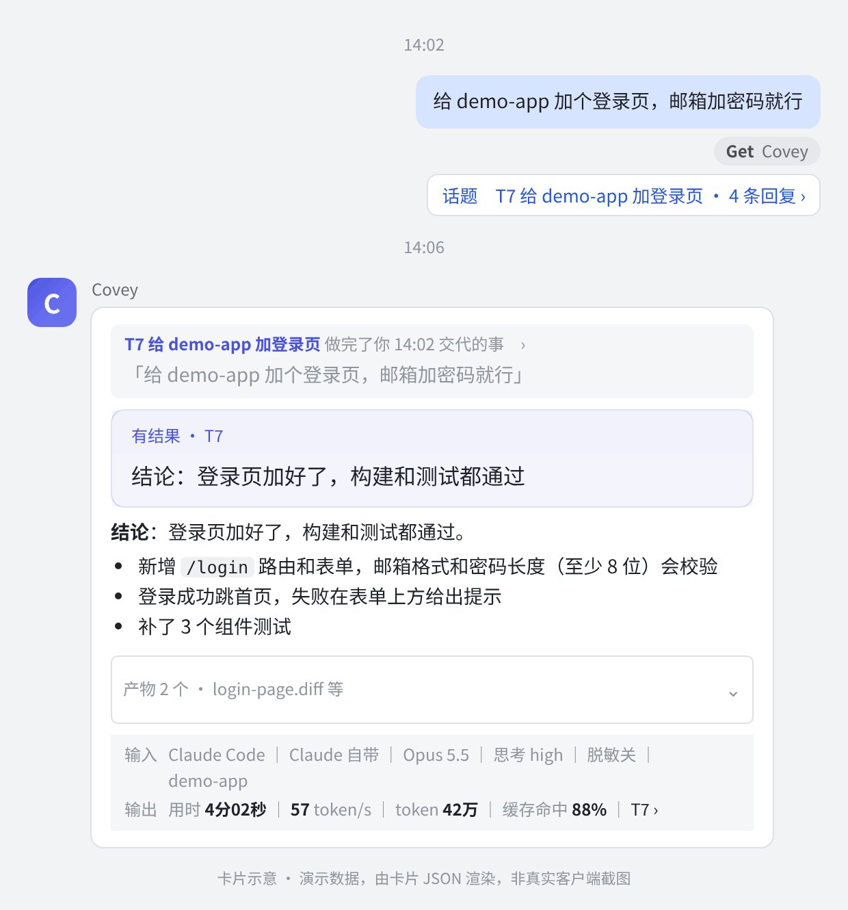
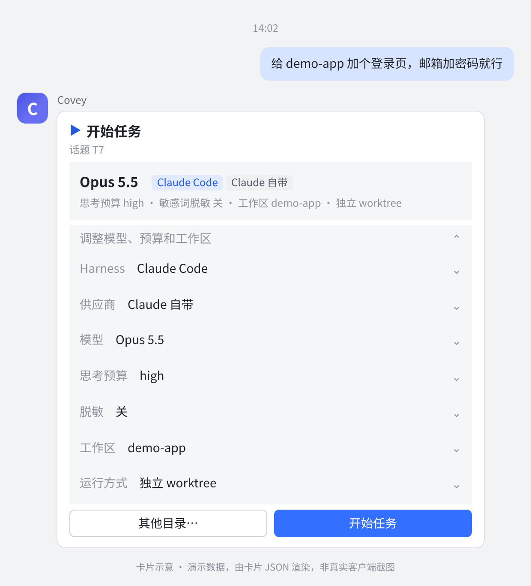
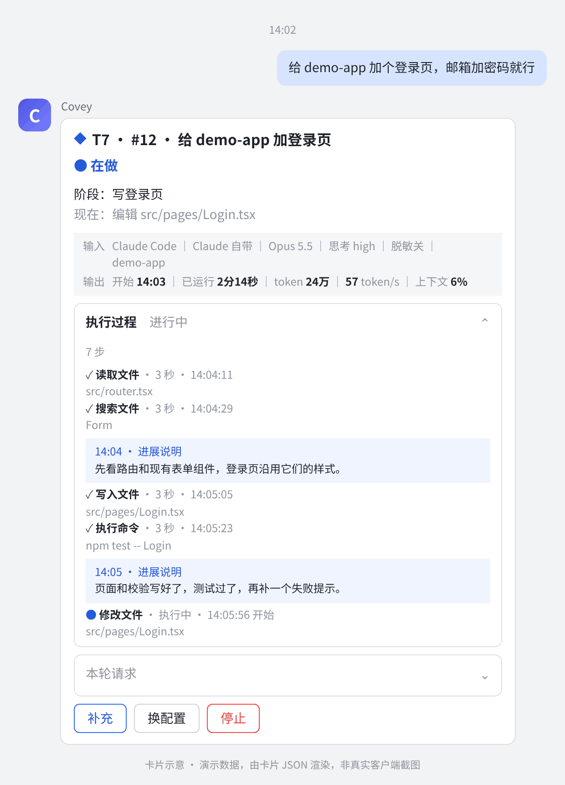
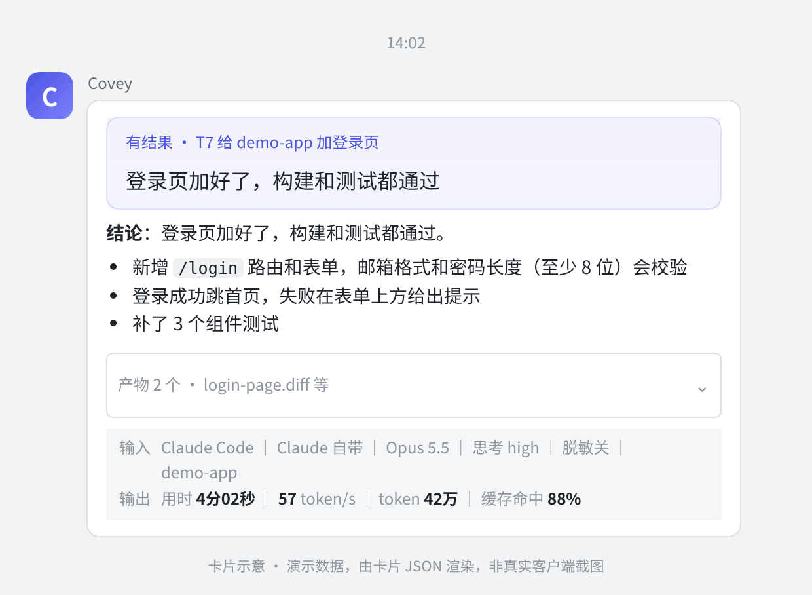

# 使用指南

这篇写给在飞书里使用自己机器人的人（下文的“你”，也就是机器人绑定的主人）：怎么开任务、选目录、补充和回答、看懂任务卡、用私聊管家和看板，以及出问题时点哪个按钮。

刚装好先照[第一次使用](#第一次使用)走一遍，再读[基本概念](#基本概念)和[开始一个任务](#开始一个任务)。本篇按第一周用到的顺序排：开任务、看任务卡、补充和回答、出错了怎么办、管家、每天看全局、群和代答，最后是需要时再翻的进阶功能。每个功能的细节（状态行怎么算、补充的送达状态、代答卡、自动重试、已下线的功能等）在[使用参考](reference.md)。部署机器人见[安装](install.md)，服务器上的维护见[运维指南](operations.md)。

## 第一次使用

下面的图是用演示数据画的卡片示意，不是真实截图，按钮和配色以飞书里为准。

1. **私聊机器人发一句话**，比如「看看当前工作目录里有什么」。部署的机器上有 Claude Code 时，私聊顶层的话交给[管家](#管家)：几秒能答的它直接答，要查、要跑、要改的它开一个话题去做，话题串挂在你这句话下面，做完把结论带回私聊。只有 Codex 等别的 Harness 时没有管家，每条消息直接开一个话题。

   

2. **看启动卡**（没有管家时每个话题都有；管家开的话题按设置卡上的“直接开工”，多数直接开工，需要你点时才出）：卡上写着要用的模型、思考预算和工作区，默认就行，点「开始任务」。要换模型或目录点「调整模型、预算和工作区」，见[开始一个任务](#开始一个任务)。

   

3. **看任务卡**：开始后话题里是一张实时刷新的任务卡，状态行写现在在做什么、用了多久，展开“执行过程”看每一步命令和文件改动。想追加要求点「补充」，想停点「停止」，见[任务卡与执行过程](#任务卡与执行过程)。

   

4. **看答案**：做完后答案单独发成一张答案卡，登记的产物上传云空间并给链接，见[结果与产物](#结果与产物)。模型要问你时出问题卡，选了提交它接着做，见[回答模型的问题](#回答模型的问题)。

   

5. **接着聊**：在话题里直接回复就是追问，同一个会话接着做；在私聊顶层发新消息就是另一件事。出错了看卡上的说明和按钮，见[停止、失败与恢复](#停止失败与恢复)。

### 有没有这个功能

有的功能要部署打开才有。机器人是别人帮你装的，或想知道还能开什么，按下表看；没有的找部署的人，或照[配置 · 开关速查](configuration.md#开关速查)打开。

| 功能 | 在飞书里怎么看有没有 |
| --- | --- |
| [管家](#管家) | 私聊发一句话是管家回答（没有就是每条直接开话题）；菜单「设置」里有「管家」标签 |
| [早晚汇总](#早晚汇总)、[看板](#看板) | 菜单里有「看板」 |
| [手上的事](#手上的事)、[话题看板](reference.md#看板自动-pin-话题) | 私聊的 Pin 里有一张「手上的事」 |
| [代答](#代答) | 菜单里有「代答」 |
| [整理专项](#整理专项)、专项 | 管家把长期的事开成专项时私聊出现专项卡；看板卡上有「整理专项」 |
| [知识条目](#知识条目) | 说“记一下 …”后，那一轮结束时卡上说记下了 |
| 记忆 | 答案卡底部有一行记下的要求和“不对”按钮 |
| [设备](#机器人菜单) | 菜单「设置」里有「设备」标签 |

## 基本概念

- **只服务你**：机器人绑定一个飞书用户。私聊里别人发的消息和点的按钮都不处理。你激活过的群里，群成员也能用，见[在群里用](#在群里用)。同事要用，请他们部署自己的机器人。
- **一条消息一个话题**：发一条新消息就开一个话题，机器人在这条消息下回复启动卡。之后的追问、补充、问答和结果都留在这个话题里。开了[私聊管家](#管家)时，私聊顶层的消息先交给管家，由它决定自己答还是开话题。
- **一个话题一个会话**：点“开始任务”后话题的配置就定了。Harness、模型、思考预算、工作区、运行方式和敏感词脱敏都可以在任务卡上点“换配置”来[更换](#换配置)。
- **编号**：每个话题有短编号（如 `T12`），每一轮任务有任务编号（如 `#196`）。任务卡标题写成“T12 · #196 · 问题开头”。
- **两种卡片**：开始前是**启动卡**，用来选配置；开始后每一轮一张**任务卡**，显示状态、执行过程和答案，停止、补充、重试都在任务卡上。
- **附件**：图片、文件、被回复的消息和合并转发都会交给模型，见[附件与转发消息](reference.md#附件与转发消息)。
- **没有文字命令**：发出的每条消息都当作任务、补充或群消息，包括以 `/` 开头的。你的操作在私聊输入框上方的[机器人菜单](#机器人菜单)里。只有配对口令 `/pair` 例外，它只在机器人还没绑定主人时、在私聊里有效。

### 机器人菜单

私聊机器人时输入框上方有一排菜单按钮，只有你点了有反应。点了以后结果作为一张卡片发到你和机器人的私聊里，不开话题：

| 菜单 | 事件 key | 打开 |
| --- | --- | --- |
| 用量 | `weekly_usage` | [本周用量](reference.md#本周用量)卡 |
| 看板 | `digest_board` | 现在在等你、停住、在做的事和专项，见[看板](#看板)（只在部署开了早晚汇总时有） |
| 代答 | `proxy_settings` | [代答卡](reference.md#代答卡)（只在部署有代答发送器时有） |
| 设置 | `bridge_settings` | 设置卡，见下文 |

**设置卡**是一张卡上一排标签：“新话题 | 管家 | 工作区 | 脱敏 | 群聊”，部署开了节点时末尾多一个“设备”。点菜单「设置」先停在“新话题”。

- “新话题”是**所有新话题**预选的配置：你自己发消息开的话题（启动卡）和管家开的话题都照它。一行一项：Harness、供应商、模型、思考预算、运行方式、脱敏、工作区；某一行选“跟上次一样”，就用你上次在启动卡上的选择，这一行写着现在会是什么。开了管家时下面多一行“直接开工”：都直接开工 / 只读的直接开工，改文件的等你点 / 都等你点开始，只管管家开的话题；选中间那档时下面列出“记住的工作区”（管家问过你“以后这类直接开工吗”、你同意过的），每项可删。最下面“更多”里是子 Agent 用什么模型（所有 Claude Code 话题和管家都照它：默认轻量，子 Agent 跑 Sonnet、搜索跑 Haiku；或者跟主模型）。
- “管家”是管家自己用的供应商、模型、思考预算、脱敏（Harness 只能是 Claude Code，写在标题下面）；“更多”里是压缩阈值和**私聊顶层的消息**：交给管家 / 每条直接开一个话题，见[管家](#管家)。部署不允许管家（`COVEY_BUTLER=0`）时没有这个标签，“新话题”页也没有“直接开工”。
- “工作区”是[工作区列表](reference.md#管理工作区列表)；开了管家时每个工作区下面一行灰字写它的“用途”，点“改用途”才出输入框，改完点“保存用途”。
- “脱敏”是[敏感词](#敏感词脱敏)：填词、词表，开关、试一下和记录收在折叠面板里，直接在卡上改；“群聊”见[在群里用](#在群里用)。代答不在设置卡上，是菜单里单独的一项。
- 点另一个标签，这张卡原地换成那个面板，不发新消息。点当前标签，卡原地收起成标题和标签行，再点展开。

菜单卡再点一下收回、每种卡只留最新一张、旧菜单项和「飞书应用待补」卡见[使用参考 · 菜单卡](reference.md#菜单卡)。

## 开始一个任务

1. 发送任务内容，机器人在这条消息下回复启动卡。卡上先是一块摘要：大字写模型，旁边两个标签写 Harness 和供应商，下面一行灰字写思考预算、工作模式（有的 Harness）、敏感词脱敏（Claude）、工作区和运行方式。
2. 要改就点“调整模型、预算和工作区”展开。一项一行：Harness、供应商、模型、思考预算、工作模式（有的 Harness）、脱敏（Claude）、工作区、运行方式。点一行，选项在下面展开；点一项就选中，整张卡重画一次。卡上没有下拉框，手机上也能顺手点。
3. 点“开始任务”。工作区不在列表里时点“其他目录…”浏览，或在浏览页的搜索框粘贴绝对路径。

启动卡上每一项的含义、预选规则和点“开始任务”之后的事见[使用参考 · 启动卡](reference.md#启动卡)。

## 选择和管理工作区

工作区是任务实际执行的目录。选法有两种：启动卡工作区一行展开的选项，或“其他目录…”浏览。第一次用的目录自动加入工作区列表，名称取目录名，重名时加 `-2`、`-3`。

目录怎么浏览、列表怎么管理见[浏览目录](reference.md#浏览目录)和[管理工作区列表](reference.md#管理工作区列表)。

## 原目录与独立 worktree

- **原目录**（默认）：直接在所选目录运行，和其他话题共用同一份文件。
- **独立 worktree**：所选目录必须在 git 仓库里。机器人从仓库当前提交（`HEAD`）新建分支 `bridge/<时间>-<话题 ID 前 8 位>`，在数据根的 `worktrees/` 下检出，话题在与所选目录对应的子目录里运行。源检出里**未提交的改动不会带过去**。

选独立 worktree 时，点“开始任务”后整张卡换成“正在创建独立 worktree…”，通常几秒到十几秒，完成后任务自动开始。

- 检出失败（包括检出期间服务重启）时，卡片换回启动表单并保留已选内容，顶部写“⚠️ 任务未启动：原因”。已经建好的 worktree 不会删除。
- 话题结束后 worktree 和分支都保留，由你合并或自己删除（例如 `git worktree remove <路径>`）。

## 任务卡与执行过程

任务卡从上到下：

1. **标题栏**：“T12 · #196 · 问题开头”。卡片标题发出后改不了。
2. **状态**：带颜色圆点的加粗状态词（[UI 规范](ui.md#3-状态词表)）：“在做”“可能卡住”“有结果”“已停止”“停住了”“等你”，结束后写几点结束。下面整行是阶段、步数、“现在：”在做什么、停止原因。
3. **输入/输出灰框**：“输入”是 Harness ｜ 供应商 ｜ 模型 ｜ 思考 xhigh ｜ 脱敏开/关 ｜ 工作区；“输出”运行中是开始时间 ｜ 已运行 ｜ token ｜ 每秒 token 数 ｜ 上下文占比，结束后是用时 ｜ 每秒 token 数 ｜ token ｜ 缓存命中比例。
4. **正文**：运行中是流式回答；结束后见[答案在哪里](#答案在哪里)。
5. 结束后按情况出现问题、重试按钮、产物。
6. **执行过程**、📝 最新补充、“本轮请求”和“任务详情”（折叠）。
7. **按钮**：排队和运行中是“补充”“换配置”“停止”；结束后是“换配置”，Claude 另有“回退”，Claude 和 Codex 再有“下载请求与结果”。

点“停止”立即停止，不弹确认框。

状态行怎么写、“预计还要多久”怎么算、执行过程放不下时怎么收、任务详情和刷新节奏见[使用参考 · 任务卡](reference.md#任务卡)。

## 追问、排队与并行

- 同一话题的任务按收到顺序**串行**执行；不同话题**并行**执行。整个机器人最多同时执行 **10** 个任务，多出的排队。
- 并行**不按目录隔离**：目录相同或重叠的话题会同时改文件，需要自己协调，或用[独立 worktree](#原目录与独立-worktree)。
- Claude（和有同样行为的扩展 Harness）的原生问题等你回答时，任务仍占一个执行名额；Codex 遇到必须回答的问题会结束本轮、释放名额。

任务执行时在话题里发的普通消息**不会传给正在执行的任务**，而是排在后面作为下一轮。想让当前任务马上看到，用[补充当前任务](#补充当前任务)。话题里有待答问题时，直接发的消息按[回答模型的问题](#回答模型的问题)处理。

排队的消息有自己的任务卡，阶段写“排队中 · 排在 #1190 后面 · #1190 已运行 1小时23分（10:05 开始）”或“排队中 · 并发已满（最多 10 个任务）”。每张任务卡上的“停止”只取消这张卡的任务：排队中的立即取消、不调用后端。

## 补充当前任务

补充是把一段新要求送进**正在执行的那一个任务**，不开新一轮。普通追问会排队，补充要显式点按钮。投递机制见[补充投递](architecture.md#补充投递)。

“补充”按钮只在支持执行中补充的后端出现：Codex、Claude、Pi 和扩展的 Harness；dsh 没有。

### 从运行卡补充

1. 点运行中任务卡上的“补充”。
2. 话题里出现表单卡“补充任务 T8 · #252”，写内容（飞书输入框单次最多 1000 字），点“提交补充到 #252”。更长的内容或附件：直接在话题里发消息，再点那条消息排队卡上的“补充当前任务”（见下）。
3. 表单换成一行回执，例如“✓ 已补充到 #252 · ✓ 后端已接收 · 当前一步结束后读到”。“查看详情”里列出各状态的时间和补充原文。

任务结束后，还开着的表单变成“任务已结束，不能再补充”，需要继续时直接在话题里发消息。

急的补充怎么打断正在跑的命令、回执上的各种送达状态、任务在等回答时和排队消息卡上的补充见[使用参考 · 补充](reference.md#补充)。

## 回答模型的问题

模型需要你决定时，问题出现在原任务卡上或一张单独的问题卡上。问题卡开头是结论带：小字“等你 · T12 #108”，大字“要你定：”加问题（几道题时写“3 个问题”），灰字说明它会不会挡住任务：“等你回答后继续”（任务等你）、“其他工作继续”（不阻塞）、“本轮已结束，可继续补充”。

- 每道题以题号和题目标签开头。有选项的题是下拉框（多选题为多选框），下面还有一个“自己写回答”的输入框：写了就以写的为准。没有选项的题只有回答框。
- 每道题都能选“不回答此题”，模型收到“用户选择不回答此题（不表示同意或授权）”。
- 卡片最下面是**补充说明（可选）**输入框，不针对某一题，模型收到单独一段“用户补充说明：…”。
- 卡片没有默认答案，不会自动提交；没有你的回答，不会被当作同意。输入框只能填文字，每个最多 1,000 字符。
- 底部两个按钮：**提交回答**（每道题都处理过才能提交）和**只发补充说明**（每道题都记为不回答，模型收到你的补充说明，用来反馈问题不合适或给新要求）。

其他回答方式：

- **只有一个待答问题**：可以直接在话题里回复（不受 1,000 字符限制）。
- **漏答或填法冲突**：机器人回一张小卡说明原因，改好后在问题卡上再点“提交回答”。
- **图片**：卡片里不能放图片。有问题待答时发的图也会交给模型：单题时随回答一起送出，多题时随暂存的补充一起送出。

多题待答时直接发的消息怎么处理、回答之后答案去了哪见[使用参考 · 回答](reference.md#回答)。

## 撤回或改了发出的消息

发错了就撤回，想改问题就直接编辑原消息，Bridge 大约 15 秒内就会发现：

- **撤回**：这条消息的任务还在排队就不执行，在跑就停下，任务卡写“原消息已撤回”。如果它是发给正在跑的任务的补充，任务会再收到一句“这条撤回了，别按它做”。这一轮已经记下的记忆和知识条目也一起作废。管家已经因为这条消息开了话题的，话题串里会出现“来源消息已撤回”和一个停止按钮，停不停由你定。
- **编辑**：正文真的改了才算（只加了话题串、表情不算），改后的内容作为补充交给这条消息的任务。还在排队的，开跑时直接按改后的做；在跑的，当前一步结束后读到。任务已经做完的不会自动重做，话题里会提示你一句，要重做就再说一句。
- 只对你自己发的消息生效；撤回或编辑超过一天，或者任务结束超过 10 分钟后才改的，不再跟进。Bridge 重启后，重启前发的消息也不再跟进。
- 回复一条被撤回或编辑过的消息时，模型会知道它已撤回（不会看到原文），或者看到的是改后的内容。

## 停止、失败与恢复

### 停止

运行中的任务点“停止”：状态行变为“正在停止…”，按钮行移除，后台结束这个任务的后端进程，结束后状态行变为“已停止”。排队中的任务点“停止”立即取消，不调用后端。停止同时取消这个任务还没回答的问题。

Claude 回复后还有后台任务时，机器人一直等它们结束、任务卡显示执行中；不想等了就点“停止”，停止前最后一条完整回复照常发出。

### 失败与“检查并继续”

失败的任务卡标“停住了”并写明原因，下方有“检查并继续”按钮，按原因还可能有“看原因”（开一轮只读排查）、“拆小再试”。点“检查并继续”排一个新任务，原卡片写明已转到新任务。任务卡没法再改时，另发一张恢复卡：开头的结论带写“停住了 · T12 #431”、原因和下一步，下面是停在哪一步、已做完的和按钮。

- 新任务带上原请求、上一轮结果和检查点。执行前机器人检查检查点里登记的、工作区内的产物是否存在，并要求模型先查询外部任务状态、禁止直接重复提交。检查点内容不是完成证明。
- 本话题还有运行或排队的任务时不能重试；重复点击不会重复入队。

常见失败：

| 卡上写 | 是什么、怎么办 |
| --- | --- |
| 本话题的工作目录不存在 | 后端没有启动。恢复目录后点“检查并继续”，或新开话题选别的目录 |
| 后端暂不可用，任务尚未执行 | Harness 没装好、没登录或环境检查失败，部署者见[排障](troubleshooting.md) |
| 模型服务限流或当前用量额度不足 | 与任务内容无关。Claude 会先自动重试（见下）；稍等后在本话题发一条消息，或点“换配置”换个模型。走模型网关的 Codex、Pi、DeepSeek Harness 任务在同一轮里自己重试 |
| 主任务结束后的等待时间已到，子任务或后续处理未全部结束 | 本轮未全部完成，没有发出回复；Claude 任务 60 秒后自动检查并继续一次 |
| 官方拒绝或降级 | Claude 的主任务或子任务带了明确的 `refusal`、`fallback`，机器人停止这一轮，不自动重试；只有一个子代理第一次被拦时不停，执行过程里记一行，主任务自己绕开。检查任务内容后提出调整后的要求，见 [policy-stop.md](policy-stop.md) |
| 扩展的 Harness（扩展 Harness）失败、取消或崩溃 | 它的会话拒绝自动续接，见公司扩展自己的 README |

自动重试、任务进程退出、任务卡没出来、结果送达失败和机器人重启时会怎样见[使用参考 · 停住以后](reference.md#停住以后)。

## 结果与产物

### 答案在哪里

- 后端交来已核验的回答时，回答单独发在任务卡下方，作为一张**答案卡**（超过 20,000 字节时作为 Markdown 文件，后面补一张只有产物和灰框的小卡）。答案卡从上到下：回答；产物（折叠，标题“产物 2 个 · REPORT.md 等”）；改了代码的轮次再有一个折叠的“改动”（提交、部署、验收，取自检查点的 `delivery`）；输入/输出灰框。
- 任务卡正文这时写加粗的“结论”和回答的第一个标题或第一句。
- 回答里的标题加粗显示，表格和代码块照常显示，只有一行的代码块改成行内代码。飞书拒收这张卡片时，回答作为 Markdown 消息发出。
- 没有单独发送的回答显示在任务卡正文，以“✅ 答案”开头。超过卡片容量时卡片保留预览并注明“完整内容会以 Markdown 文件发到本话题”。
- 答案里用 Markdown 图片语法引用的本机图片（绝对路径或相对工作区）会上传并显示为图片。
- 任务改了 git 工作区里的文件时，答案末尾附修改摘要（文件数和前 10 个文件），完整差异报告作为产物上传。

- 要你马上看的图片（登录二维码、要你确认的截图）不等这一轮结束：任务把图片写进检查点的 `show_images`，机器人读到就发到这个话题的串里，先一行说明、再一张图片（手机上长按能识别二维码）。标了 `urgent` 的，同时在私聊聊天区再发一份，第一行写“T号 · 说明”并带“到话题里看 ›”链接；在话题串里没发出去的也会发到聊天区。管家自己的只发在聊天区。同一张图只发一次，同一个文件改写后（比如二维码刷新）会再发；这只在这一轮还在执行时生效（`app/turn_images.py`）。

产物上传到云空间和“下载请求与结果”见[使用参考 · 产物与导出](reference.md#产物与导出)。

## 长任务与检查点

每个任务有一个检查点文件，机器人在提示词里把路径和写法告诉模型：开始执行、完成阶段、生成产物、提交外部任务、需要你决定时，模型把当前进度写进去。你不用写它，看到的是它在卡上的样子：

- **状态行**写当前阶段；长任务列了步骤时写“第 3/5 步：<步骤> · 本步 40 分钟”，看板的状态卡和管家的快照也写第几步。
- **产物**：模型登记的文件在任务完成后上传云空间，见[产物上传到云空间](reference.md#产物上传到云空间)；要你马上看的图（登录二维码、要你确认的截图）在任务还在跑时就发到话题里。
- **要你决定**：本轮结束时先发正文再出问题卡，任务标为等你回答并释放执行名额；回答后续接任务带着原检查点在同一会话里继续，见[回答之后](reference.md#回答之后)。
- **改了代码的一轮**：答案卡和聊天区的结论卡上多一个折叠的“改动”，收起时一行“改动 · <提交号前 7 位> · <部署> · 已验收/未验收”。
- 任务中断时，恢复卡上写着检查点里最后的阶段，点“检查并继续”时模型先读检查点再接着做。

检查点里不写密钥。字段的完整清单（阶段、步骤、产物、问题、交付、话题要点、记下的事、代发草稿等）是写给模型的约定，以 `core/checkpoint.py` 和机器人每轮发给模型的说明为准，不在这里列。

## 管家

私聊有两种模式，在设置卡「管家」页“更多”里的“私聊顶层的消息”一行切换：

- **交给管家**：你在私聊**顶层**直接发消息，由一个常驻的 Claude Code 会话回答，它叫管家。下面说的都是这个模式。
- **每条直接开一个话题**（纯话题）：顶层发一条消息就开一个话题，和没有管家时一样。

部署设了 `COVEY_BUTLER=0` 时没有管家，卡上也没有它的标签。设计和实现见 [butler.md](butler.md)。

**它做什么。** 只读、一两分钟能查完的，它直接答。其余的交给话题去做：新的事开一个话题，话题串挂在你这条提问下面；跟已有话题是同一件事（你提了 T 号、在说刚才那件）就追加过去。两个以上话题都像时，它出一道单选题问你。一句话里有几件事就开几个。

**聊天区只留你的提问和要你看的消息。**

- 你发一句话，它先不发卡，只在这句话上加一个表情：开工时 “OnIt”，自己答完换成 “DONE”，交给话题换成 “Get”，失败或被拒换成 “❌”，你停了或它要你回答时表情去掉。
- 一轮跑过 90 秒还没完，它的卡才发出来，在你这句话的话题串里，能看进度、能停止。卡结束时状态行写它做了什么（“✅ 已答：开头”“↪ 开了 T44「标题」”“↪ 交给 T42 接着做”“↪ 拆成 2 件”）。
- 它直接给的答案、话题每一轮的结论、要你回答的问题卡，都作为新消息出现在聊天区最下面。最上面一块灰底写“你问 · 12:31 ›”和你那句话的原文（表单作答开的一轮写“你答”和“问题 → 回答”）。这一轮属于哪个话题，点了就跳到那个话题串里这一轮的位置；管家自己答的，点了回到你那句话在聊天里的位置。
- 只交给了话题、没说别的的一轮不另发答案，表情 “Get” 就是回执。
- 这一轮失败、被拒或超时，聊天区另发一条带“你问”的短消息说明；答案没发出去时，这条消息上有“重新投递结果”或“检查并继续”。

**话题的结果。** 话题每一轮结束时在聊天区另发一条结论，和话题串里的答案卡一个样子，“输出”那行末尾多一个 T 号，点了跳到这一轮的卡。你自己点停止的那一轮不发。引用这些卡回话，就是对那个话题说。

**问题。** 话题要你回答时，问题卡在话题串里和聊天区各一张，聊天区那张上面带这一轮的输出。只有一道单选题时每个选项一个按钮，点了就提交。在哪张上答都一样，答了两张一起收起。

**它能替你转话。** “T12 选 A”会替你答那个话题的选择题，“T12 急”会把那个话题在看板里提前，“T12 不用管了”会把它从看板撤下，“从 T12 分出去看看另一种做法”会开一个带着原话题背景的新话题。它还能按链接、路径或关键词找出是哪个话题哪一轮做的。

**交给话题的是什么。** 话题的模型收到管家整理的任务说明，加上你的原话和这条消息的图片、文件。话题的卡上只显示你的原话。

**记住你的原则。** 跟它说“以后……”“原则是……”“记住……”这类长期适用的话，它会记下来并回一句“已记下：……”。之后每个话题（不管用哪个 Harness）和它自己的每一轮都会带上。只对某个工作区成立的记在那个工作区下；通用的只在你自己发的消息那一轮带上。说“记了哪些原则”它会列出来，说“忘掉那条……”它会删掉。

**话题照旧。** 在话题里回复，或回复话题里的卡片，还是交给那个话题，不经过管家。群聊不变。

**不用管家**：在「管家」页“更多”里把“私聊顶层的消息”选成“每条直接开一个话题”，卡上先说一句改了会怎样，点“确定改”才生效，顶层的新消息就各开一个话题。这时「管家」页只剩这一行，选回“交给管家”马上改回。正在回答的那一轮会做完；管家开过的话题照常在各自的话题串里继续，只是结论不再回到顶层。管家的会话留着，改回时接着用。Claude Code 暂时不可用时，顶层消息也会照旧新开话题。

它在回答时你又发了消息、先转发再说要做什么、它自己的设置见[使用参考 · 管家的细节](reference.md#管家的细节)。

## 手上的事

部署开了「手上的事」（见[配置](configuration.md#手上的事与话题看板)）时，机器人在你的私聊里发一张「手上的事」卡并置顶（Pin），点私聊顶上的 Pin 就能看到。卡原地更新：

- **等你**：在等你的事，最新的在前：话题和管家、负责人问你的问题，还有等你在启动卡上点开始的消息。点话题号直接打开那张问题卡或启动卡。等了一天以上的不再单列，最后一行灰字写有几个和它们的话题号，旁边是“不管了”（开了话题看板时才有按钮）。
- **在做**：排队和在跑的任务，先开始的在前，写几点开始的、阶段、Harness 和工作区。
- **刚结束**：刚完成、失败、停止或中断的任务，留 10 分钟。
- 每部分最多列 8 件。只有内容变了才重画（最多每 15 秒一次）。只列私聊里的任务，群里的不列。
- 卡只置顶一次：你在 Pin 里取消后不会再 Pin 上。每 7 天换一张新卡并置顶，旧卡改成“已不再更新”。

部署再开了话题看板时，Bridge 把私聊里的话题自动 Pin 出来，「手上的事」固定在 Pin 列表最下面当索引；顺序、做完的留多久，以及“等你”“有结果没看”在各处的同一个口径，见[看板：自动 Pin 话题](reference.md#看板自动-pin-话题)。

## 早晚汇总

部署开了早晚汇总（见[配置](configuration.md#早晚汇总)）时，每天到设好的时间（比如 09:30、23:30），机器人在私聊里发一张汇总卡：

- **等你**：和看板的“等你”同一批（见上面[看板](reference.md#看板自动-pin-话题)）：每个话题最新的待回答问题，或等你在启动卡上点开始的消息，专项里的话题也列在这里。等了一天以上的合成一行“另有 N 个等了一天以上：T…”，也算进个数。
- **在做**：在跑或排队的。
- **做完**：上一次汇总之后做完的，加上更早做完、你还没看过的（和看板的“有结果没看”是同一批，标题里写“另有更早没看的 N 个”）；不在“有结果没看”里的灰字标“已看”。
- 每行点 T 号打开那个话题；“等你”的行打开那张问题卡或启动卡，菜单「看板」上的按钮写“去回答”或“去开始”。每组最多 8 行。你从看板撤下的话题不列。三组都空就不发。
- 部署开了知识条目时，卡的末尾多一节“新记的知识”：上次汇总以来新增、改写、作废的条目，最多 10 行；只有这一节时汇总不会单独发出来。
- 开了手上的事和话题看板时，那一行带「不管了」，和手上的事那个按钮一样；点了这一行变成灰字“已撤下 N 个”。

随时想看就点菜单「看板」。它和早晚汇总是两张卡：早晚汇总写这段时间发生了什么，看板写现在的状态。看板不影响定时汇总。

## 看板

点菜单「看板」，私聊里来一张「看板」卡，标题旁是几个等你、停住了、可能卡住、在做，数法和结论带一样。最上面一条结论带：“要你处理 N 件事”（等你、停住了、可能卡住加起来），下一行“先看：”最急的那个话题（点结论带打开它），再下面一条分段条按件数画出各状态；没有要你处理的写“都在掌握中”。下面每个话题一行，前面是状态的圆点和词，整行点了打开那个话题，标题后有“›”；打不开的那行灰字写“找不到它在私聊里的位置，打不开”。时间写到分钟（“等了 45 分钟”）：

- **等你**（橙）：要你定什么（那个话题最新一轮写的阶段）、等了多久，右边「去回答」。等了一天以上的合成一行，带「不管了」。
- **停住了**（红）：失败、中断、被负责人、专项护栏或代答停下的话题，写为什么停（负责人、护栏、代答停的写明是谁）、停在哪一步、几点停的、下一步点什么；右边「去任务卡」打开那次任务的任务卡（「检查并继续」在那里），「不管了」把它从看板撤下（有了新动静会回来）。
- **有结果没看**（绿）：做完了你还没看的，写结论的第一句；右边「记为看过」直接把它挪进下面的折叠，和网页上的“记为看过”一样。
- **在做**（蓝）：现在在干什么，步骤进度条、预计还要多久、几分钟前有动静、已跑多久；超过 30 分钟没动静的换成橙色“可能卡住”，右边「去任务卡」（任务卡上有「看看」）。
- **专项**（灰）：标题写“专项 N 个”和“M 个提议等你定”。每个专项一块，写目标和它的话题里几个等你、停住、在做；它的话题不再单独列在上面。等你定的提议也列在这里（紫色），话题都能点开，右边「建专项」「不管了」直接定，定了看板原地重画，不用回聊天里找提议卡；要改名或增删话题，在提议卡的表单里改。部署开了整理专项时，这里是「整理专项」按钮（只在这里有）。
- **做完、已停止**：上一次早晚汇总以来做完、都看过的话题，和你自己停掉的话题（任务卡上的停止、跟管家说停、网页上停、撤回原消息），收进最下面的折叠里（“09:30 以来做完的话题 N 个”，有你停的时写“做完 N 个 · 已停止 M 个”），和专项无关；折叠里每个话题号都能点开。
- 最后一行“更新于”旁边是「刷新」，原地按现在重算。再点一次菜单「看板」是收起，再点展开。什么都没有时结论带写“都在掌握中”。
- 手上的事和早晚汇总用同一套词：等你、在做、有结果、做完、停住了、已停止。

## 在群里用

群里的消息要 @ 机器人才会到达，话题里的回复也要 @，@所有人 不算。机器人先去掉 @ 它的部分再处理。部署打开了免@ 时，可以按群选谁不用 @，见下面“免@”。

- **激活**：你第一次在某个群 @ 机器人时，机器人查询这个群，不是外部群就激活。激活后群里所有成员 @ 机器人都能开任务、追问、补充、回答问题、点卡片；激活前只处理你。外部群一直只处理你。
- **群聊卡**：设置卡「群聊」标签列出记录过的群，每个群的状态（已启用 / 已停用 / 未确认 / 外部群），已启用的可以“停用”，其余可以“启用”。停用后只处理你，你再 @ 也不会自动激活。群里发“停用本群”是普通任务。
- **免@**（部署打开时才有）：每个群一行多一个“免@”按钮，选这个群里谁说话不用 @：**关闭**、**只有你**、**你和选中的人**（列出群成员）、**群里所有人**（每个人的每句话都会开任务，以你的全部权限运行）。成员只在已启用的群里免@；代答在用的群不能免@。免@ 的群里 @ 了别人却没 @ 机器人的消息当作在跟别人说话，不接。两个机器人在同一个群都开免@ 时每句话两个都会接，一个群只给一个开。
- **看得到什么**：群里的人都看得到启动卡、任务卡、执行过程、答案和产物文件。
- **权限**：群成员开的任务和你开的一样，在你的机器上以你的全部权限和凭据运行（文件、git、模型密钥、飞书机器人身份）。只在信得过的群里激活。
- **谁发的**：群里每条消息交给模型时，第一行写明发送者（“发送者：主人”或“发送者：群成员 …”）。
- **只有你能做**：管理工作区列表、选择其他目录、配对（只在私聊）。群成员点“添加或管理工作区…”或“其他目录…”时，卡上提示“仅机器人主人可以…”。
- 其余被拒的消息和点击都不回复，只在 `bridge.log` 记一行。

## 代答

机器人可以替你回复白名单里的人和群：私聊里对方发来的消息，白名单群里 @你 的消息（@所有人 不算）。它以你的身份发出，不加标注，看起来和你自己发的一样。只有你能设置。部署要先配好代答（见[配置](configuration.md#代答)），实现见[代答](proxy.md)。

代答卡上每一项和代答怎么工作（合并回复、什么时候不回、没发出去时）见[代答卡](reference.md#代答卡)和[代答怎么工作](reference.md#代答怎么工作)。

### 话题以你的身份发消息（代发）

话题要以你的身份给同事发飞书消息时（比如把开好的 key 交给对方），这一轮结束后话题里出一张“✉️ 代发草稿”卡，私聊区顶层也提示一行。卡上写发给谁（姓名、部门、邮箱）、为什么发，正文在输入框里可以直接改。点**发送**才以你的身份私聊发出，发出的是框里的内容；点**不发**就不发。同名多人时先点选是谁。发出后卡上和话题里各说一句，话题之后的轮次也知道结果；没发出时卡上写原因，可以改了再点**重新发送**；结果不明的标“可能已发出”，不会自动再发。只有你能点。这个功能跟着代答的发送器：部署没有发送器时没有。

## 换配置

话题聊到一半想换 Harness、供应商、模型，或者换工作区、运行方式、敏感词脱敏时，不用新开话题：在任务卡（排队、运行中和结束后的都有）上点 **换配置**。在话题里发“换配置”是普通的补充或追问。

1. 话题里出现一张“换配置”卡，第一行是当前配置。下面是和启动卡一样的清单：点一行展开选项，点一项选中，卡片重画。和当前配置不同的那一行名称变成蓝色加粗；一项都没改时“确认更换”是灰的。
2. 分级选 Harness、供应商、模型。提供工作模式的 Harness 的模型还有工作模式一行。
3. 工作区（不能在这里输入新目录，先在设置卡「工作区」里添加）和运行方式。
4. 选中 Claude 的模型时还有脱敏一行。开着脱敏时选了不能脱敏的模型，卡上写明确认后本话题会关闭脱敏，点“确认更换”先弹确认框。
5. 点“确认更换”。成功后卡片变成“🔁 已换配置”，逐项写改了什么。点“取消”则话题保持原样。

确认更换时的检查、更换后会话怎么接（交接摘要等）见[使用参考 · 换配置之后](reference.md#换配置之后)。

## 回退一步

Claude 话题结束的任务卡最底下有 **回退**，用来去掉话题最新的一轮：

1. 点了出现一张“回退一步”卡，写着要去掉的这一轮，和这一轮 Claude 用编辑工具改过的文件（“改回这一轮之前”或“删除（这一轮新建的）”）。
2. 有改过的文件时三个按钮：“对话和文件都回退”“只回退对话”“取消”；没有改过文件时是“回退这一轮”和“取消”。
3. 确认后卡片变成“✅ 已回退一步”。下一条消息接在上一轮后面：这一轮的提问和回答 Claude 不会再看到，这一轮待答的问题作废。

文件怎么改回、什么时候不能回退、怎么撤销回退见[使用参考 · 回退](reference.md#回退)。

## 敏感词脱敏

话题开了敏感词脱敏，模型请求离开本机前，词表里的词会换成替身词（自动用“RX + 8 位十六进制”），模型回复和工具调用里的替身再换回原词，所以文件、命令和话题里的回答仍是原词。只有 Claude 的模型能用。

- **在启动卡上选**：选中 Claude 的模型时有“脱敏 · 关 / 开”一行。中途在[换配置](#换配置)卡上打开或关闭，会话不变，下一条消息起生效。
- **每轮的结果**：任务详情里有一行“敏感词脱敏：本轮替换 N 处（词表 K 个词）”。卡片上不出现词本身。
- **词表在设置卡上**：点菜单「设置」的「脱敏」标签，填词、删词、搜索、试一下都在卡上，见[使用参考 · 脱敏词表](reference.md#脱敏词表)。
- **覆盖不到的**：图片、PDF 里的文字不替换；本机的会话记录和飞书里仍是原词，脱敏只防模型厂商。其他 Harness 和代答话题不支持。

## 知识条目

部署开了知识条目（`COVEY_KNOWLEDGE=1`，见[配置](configuration.md#知识条目与历史搜索)）时，你说“记一下”的东西会存成短条目，之后的话题都带着。

| 你说 | 发生什么 |
| --- | --- |
| 私聊顶层：“记一下：发版前先跑全量” | 管家记一条，回复里列出 id 和正文 |
| “把 T48 的结论记一下” | 管家先读那一轮再起草，记完列出来 |
| 在某个话题里：“这个坑记一下……” | 那一轮模型把要记的列在回复里，Bridge 在那一轮结束后记下；只有你本人说了“记一下 / 记住 / 记下来”才记，代答话题和开了脱敏的话题不记 |
| “把 k1a2b3c 改成……”“删了那条” | 管家改写（旧的留作历史）或作废 |
| “我记过什么关于……” | 管家搜条目；“包括改过的”也搜已取代、已作废的 |

- 每条最多 200 字，分决定、做法、坑、事实、待定五类；通用的所有话题都带，只对某个工作区的只有那个工作区的话题带。同一组里意思相同的不重复记。
- 新话题的第一轮带最近的条目（总共约 1500 字，超出的是较早的）；续接的会话只补上一轮之后新增或改动的。
- “以后都要……”这类长期的做法和偏好仍是[主人的原则](butler.md#主人的原则)；一件具体的事实、决定或坑记成知识条目。
- 部署还配了历史搜索（`COVEY_HISTORY_CMD`）时，话题里的模型和管家在你问“之前 / 上次 / 那个 X 怎么弄的”时会自己查：管家先查知识条目，再按链接、路径找话题，最后搜全部历史轮次。

## 整理专项

部署开了整理专项时（`./install` 装好默认就开“只提议”，见[配置](configuration.md#整理专项)），专项会自己长出来，不用你手动转。专项是一件要分几个话题、跨几天推进的事，由一个负责人带着：看板上它的话题并成一格，问题先由负责人过一遍，进展由它汇报。

- **话题要点**：每个话题每轮结束时，自己写几行“这件事本质上在做什么”。开头聊的是一件事、后来改成另一件，要点会跟着改。
- **什么时候整理**：开了新话题、话题的本质变了、话题做到第 3 天或你在里面说到第 15 句时，看这一个话题；每天早晚汇总的时间点整理一遍全部；你随时可以对管家说“整理一下专项”（也可以说“只整理 Covey 相关的”），或点机器人菜单「看板」卡专项区的「整理专项」（只在看板上有），或在网页上点「整理」。话题还不到 5 个时不整理。
- **能归进已有专项的直接归**：话题卡、状态卡上多一行“已归进专项「X」 · 移出”。归错了点「移出」，这个话题以后不会再被自动归进专项；可以顺手写一句为什么，整理以后照这句话来。
- **要新建专项的先问你**：私聊里来一张“建个专项？”卡，写着哪几个话题、专项名和目标、建了有什么变化。点「建专项」就建；「改个名再建」可以先改名字和目标，你取的名字以后不会被改掉；「不用」以后不会再这样提，除非又多出相关的话题；「以后别提议」就不再弹（你说“开个专项”照样能开）。连着 5 次直接点了建，卡上会问要不要以后直接建。
- **整理专项卡**：定时和手动的整理出一张“整理专项”卡，读话题时显示“正在读 T48（12/40）”，读完原地换成结果：已经替你做了的（归进、收起空闲的专项）列在上面；每个新专项另发一张提议卡（话题全列出、能点开、带摘要，可以增删话题、改名，再点「建专项」），整理卡上只列它们的名字；合并、拆开、改名、移出最多 5 条，话题同样全列、能点开，每条「好」「不用」逐条确认，没有“全部照办”。专项要有终点、至少两个话题：只有一个话题的、长期值守没有终点的，都不提。有话题读不了时只跳过它，卡上写明是哪几个、为什么（比如官方内容安全拦了、内容太长）。
